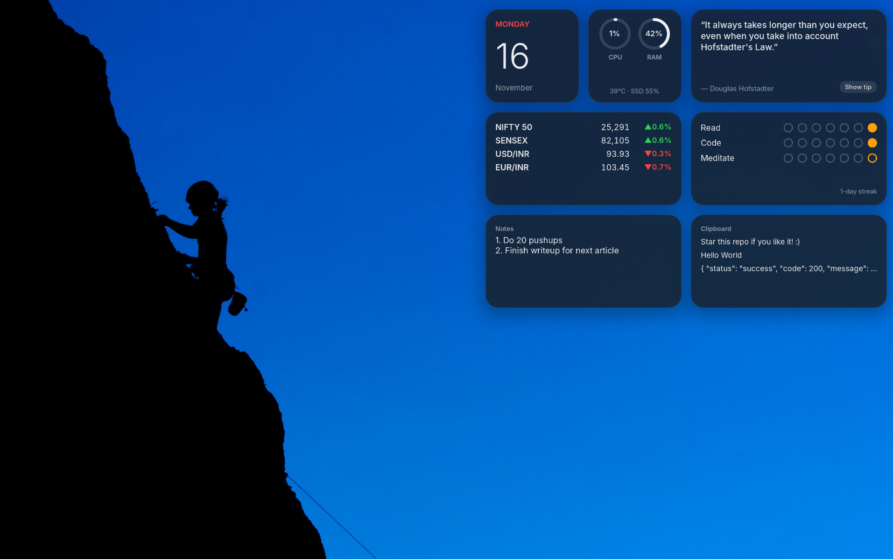
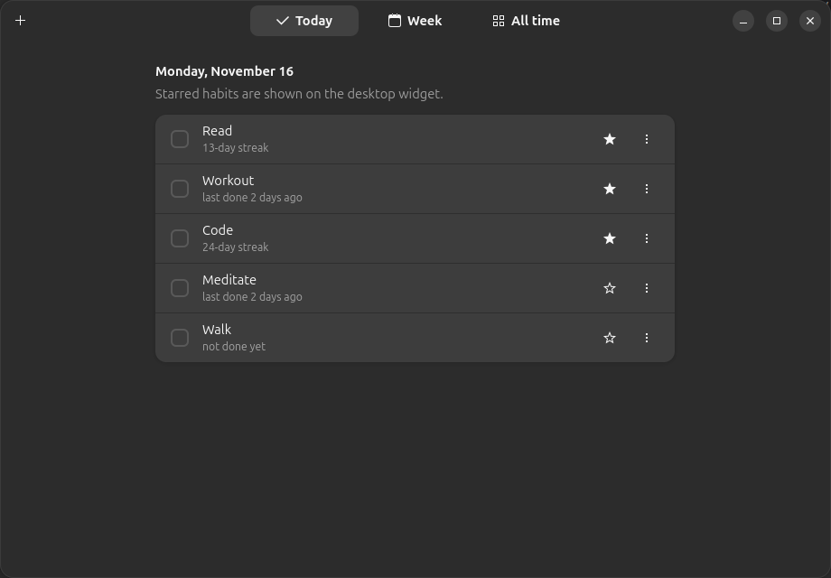
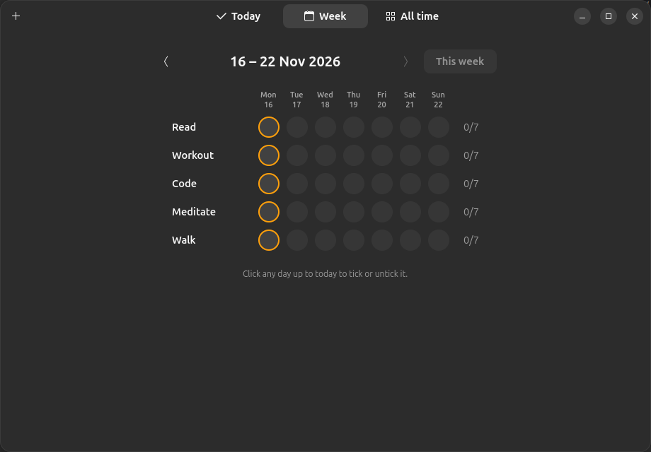
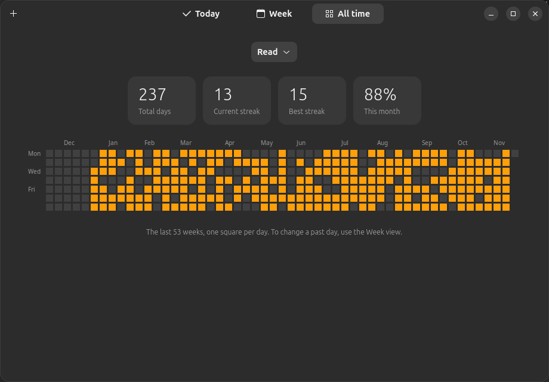

# Desk Widgets

Calm, Mac-style widgets on the Ubuntu desktop, plus a small habit tracker app.
A GNOME Shell extension for GNOME 50.



| Widget | What it shows |
|---|---|
| **Calendar** | Weekday, date and month. Optional larger size with a month grid. |
| **System Stats** | CPU and RAM rings, CPU temperature, disk used. |
| **Quote / Dev Tip** | One per day from a bundled list. A button flips between the two; click the text to copy it. |
| **Markets** | Up to four stocks, indices or currency pairs with the day's change. |
| **Habits** | Any three of your habits with the last seven days. Click today's dot to tick it. |
| **Quick Notes** | Your pinned note, editable in place. It scrolls with the cursor, and **Open** shows it in the Notes app. |
| **Clipboard** | Your last four copies; click one to copy it again. |

The cards sit on the desktop itself: below your windows, not in Alt-Tab, and
they follow the system light or dark style. Drag a card to move it (it snaps
to a grid). Right-click a card for **Hide** and **Settings**.

## Habit Tracker

Opens from the app grid, or from the Habits card's menus.

| Today | Week | All time |
|---|---|---|
|  |  |  |

- **Today:** tick any habit; star the three that appear on the desktop card.
- **Week:** a Monday-to-Sunday grid. Go back through earlier weeks and tick or untick any past day.
- **All time:** a 53-week grid per habit, with total days, current and best streak, and this month's percentage.
- Add, rename and delete habits. Renaming keeps the history.

The app and the desktop card share one file and watch it, so a tick in one
shows up in the other.

## Notes

Opens from the app grid ("Notes (Desk Widgets)"), or with **Open** on the Notes card.

- A list of all your notes on the left, newest first, with search (Ctrl+F). Ctrl+N starts a new note.
- The first line of a note is its title.
- The pin button chooses which note the desktop card shows.
- Delete moves a note to the Trash, so it can be restored from Files.
- Each note is a plain text file, so you can also open, back up or sync them yourself.

The app and the desktop card watch the same files, so an edit in one shows up in the other.

## Requirements

- GNOME Shell 50 on Wayland. Developed and tested on Ubuntu 26.04 only.
- `gjs`, `make` and `glib-compile-schemas` (all present on a default Ubuntu desktop).
- Works with Ubuntu's Desktop Icons (DING) enabled.

## Install

```bash
git clone https://github.com/nisarg-gandhi/desk-widgets.git
```

```bash
cd desk-widgets && make install
```

Log out and back in (Wayland only loads new extensions at login), then:

```bash
gnome-extensions enable desk-widgets@nisarg-gandhi.github.io
```

Settings: right-click any card, or

```bash
gnome-extensions prefs desk-widgets@nisarg-gandhi.github.io
```

## Uninstall

```bash
gnome-extensions disable desk-widgets@nisarg-gandhi.github.io && make uninstall
```

Your data files (below) are left in place; delete them by hand if you want.

## Your data and privacy

| What | Where |
|---|---|
| Habits | `~/.local/share/desk-widgets/habits.json` |
| Notes | `~/.local/share/desk-widgets/notes/` (one `.md` file per note) |
| Last market prices | `~/.cache/desk-widgets/` |
| Clipboard history | memory only; never written to disk or logs |

- Nothing leaves your machine except the Markets requests: stock symbols go
  to Yahoo Finance and currency pairs to frankfurter.dev. No account or key.
- Copies that a password manager marks as secret are skipped by the Clipboard card.
- If `habits.json` is edited by hand into something unreadable, it is copied
  to `habits.json.bak` before the next tick replaces it.

## Known limitations

- **Stock prices use an unofficial Yahoo Finance endpoint.** It can change or
  stop working without notice. Prices are for a glance, not for trading.
- Primary monitor only. No resizing beyond the fixed card sizes.
- On a small screen, cards that do not fit are not shown; hide others to make room.
- A card is dragged by its body, not by its buttons or text box.
- If the same note is edited on the card and in the app at the same moment, the later save wins.
- A very large clipboard copy is read in full before it is cut to 10,000 characters.
- The cards are not drawn in the overview, and may not take part in the
  workspace-switch animation.
- The calendar shows the date only, with no events. Habits have no reminders or goals.

## Development

```bash
make test                 # unit tests for lib/logic (plain gjs)
```

```bash
make shelltest S=layout   # a scripted check in a separate headless GNOME Shell
```

```bash
make nested               # a visible test shell (needs mutter-dev-bin)
```

Scenarios: `layout visible stats habits quotenotes notesapp clipboard markets prefs scale leak faults habitapp look`.
The test shell uses its own settings and data folders, so it cannot touch
your real session. `lib/selftest.js` drives those scenarios and is not
copied by `make install`.

Layout of the code:

| Path | Purpose |
|---|---|
| `extension.js` | Entry point; registers the widgets |
| `lib/layer.js`, `lib/widget.js` | The desktop layer and the shared card (drag, snap, menu) |
| `lib/widgets/` | One file per widget |
| `lib/logic/` | Pure logic with unit tests |
| `app/habits.js`, `app/notes.js` | The Habit Tracker and Notes apps (GTK 4 / libadwaita) |
| `prefs.js` | The settings window |

### Add a widget

1. Create `lib/widgets/<id>.js` exporting a class that extends `Widget`.
   Override `build()` and `refresh()`; add children to `this.body`. Use
   `this.every()`, `this.after()` and `this.track()` so timers and signals
   are cleaned up for you.
2. Register it in `extension.js` and give it a default cell in
   `DEFAULT_CELLS` (`lib/logic/grid.js`).
3. Add a switch for it in `prefs.js`.

How the layer stays clickable above Desktop Icons is explained in [SPIKE.md](SPIKE.md).

## Credits

Built with [Claude Code](https://claude.com/claude-code). Quotes are short,
attributed sayings; dev tips are original to this project.

## Licence

GPL-3.0-or-later. See [LICENSE](LICENSE).
